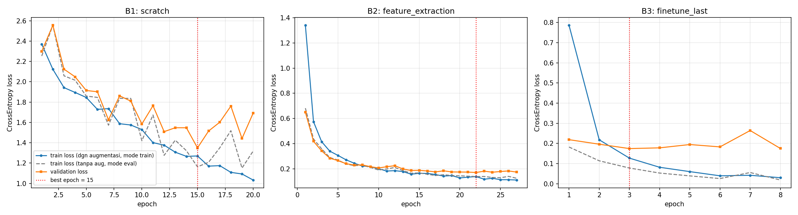
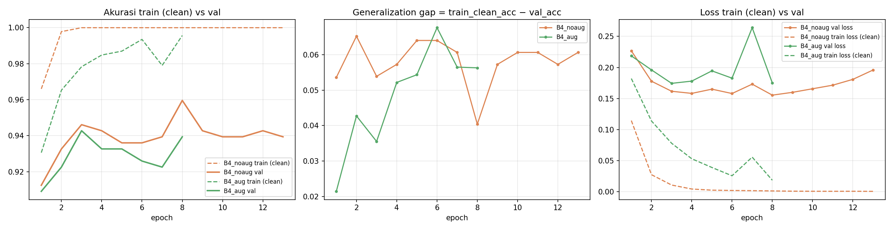
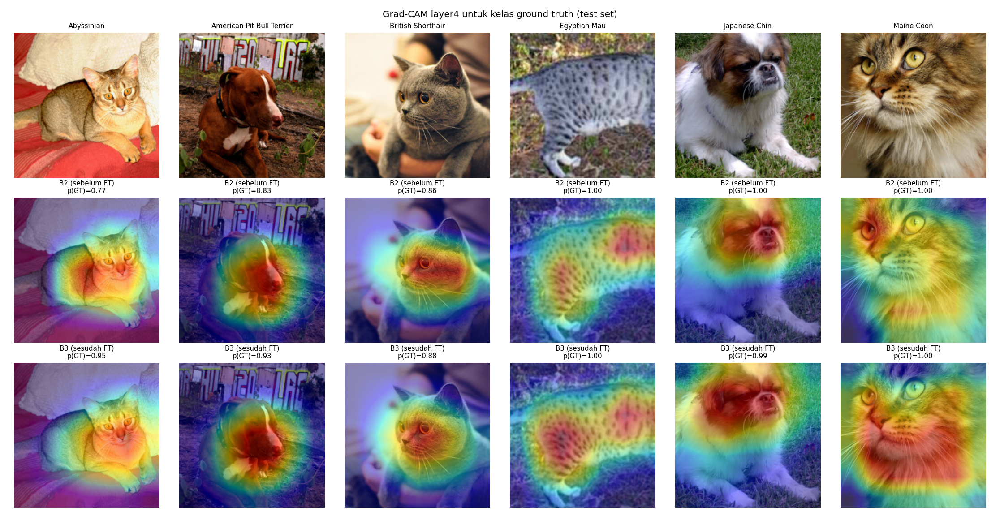

<!--
Draf laporan. Teks naratif (Ringkasan, Bagian A, C2–C5, hipotesis C3) disusun dengan bantuan AI berdasarkan log eksperimen
dan citra hasil run, atas ketentuan dosen yang mengizinkan bantuan AI; mahasiswa telah meninjau dan menyetujui (konfirmasi 12 Okt 2026).
Token {{...}} diisi otomatis oleh `python tools/finalize.py report` dari outputs/results/. Jangan diisi manual.
Hipotesis C3 disimpan di docs/C3_hipotesis.csv (CSV log mentah tidak diubah). Komentar HTML tidak tampil di PDF.
-->

# Laporan Tugas Take-Home Sesi 05: Transfer Learning untuk Klasifikasi Citra dengan Data Terbatas

**Nama:** Nicholas Salim · **NIM:** 2802420776 · **Repositori:** https://github.com/nichsalim/DeepLearning-TransferLearning

## Ringkasan
Laporan ini membandingkan pelatihan ResNet-18 dari nol (B1), feature extraction (B2), progressive fine-tuning `layer4` (B3), dan uji kontrol augmentasi (B4) pada 10 ras Oxford-IIIT Pet, ditambah EfficientNet-B0 (B5). Transfer learning menaikkan Macro F1 test dari 0,4957 (B1) menjadi 0,9254–0,9762. Selisih B2 dan B3 tidak signifikan; augmentasi memperkecil generalization gap tanpa menaikkan akurasi; B5 mencapai Macro F1 tertinggi (0,9762) dengan total parameter terkecil.

## 1. Metodologi
**Dataset.** Oxford-IIIT Pet (Parkhi et al., 2012). Split resmi `trainval` dan `test` digabung, lalu dipilih 10 ras (5 kucing, 5 anjing) secara acak dengan seed 42: {{CLASS_LIST}}. Total {{N_TOTAL}} citra dibagi secara stratified 70/15/15 menjadi {{N_TRAIN}}/{{N_VAL}}/{{N_TEST}} citra (`split.csv`).{{DROPPED_NOTE}}

**Protokol.** ResNet-18 (torchvision), input 224×224 dengan normalisasi ImageNet, batch 32, AdamW (`weight_decay=1e-2`), CrossEntropyLoss, early stopping pada validation loss (patience 5, maksimum 40 epoch), seed 42. Checkpoint adalah epoch dengan validation loss terendah; test set dievaluasi sekali pada checkpoint tersebut. BatchNorm pada bagian yang dibekukan dijalankan dalam mode eval agar statistik pretrained tidak berubah, dan hal ini diverifikasi otomatis. Augmentasi train mengikuti starter code (RandomResizedCrop 0,8–1,0, HorizontalFlip, Rotation 15°, ColorJitter 0,2); val/test memakai Resize 256 + CenterCrop 224. B5 memakai konfigurasi ResNet terbaik menurut validation (B4_noaug) pada EfficientNet-B0, dengan `features[6:]` dan classifier dibuka. Lingkungan: {{ENV}}.

## Bagian A — Analisis Konseptual
**A1. Efek regularisasi Batch Normalization (Slide 6–8).** BN menormalisasi aktivasi dengan rerata dan variansi mini-batch, lalu menerapkan skala γ dan geser β (Slide 6–7; suku β terpotong pada Slide 7, dilengkapi dari Ioffe & Szegedy, 2015). Karena statistik dihitung dari sampel yang kebetulan berada dalam batch yang sama, keluaran tiap sampel memperoleh gangguan acak yang bergantung pada komposisi batch. Gangguan ini bekerja seperti injeksi noise sehingga menimbulkan efek regularisasi ringan (Slide 8; Luo et al., 2019); saat inferensi BN memakai running statistics sehingga deterministik. Klaim bahwa BN menghilangkan kebutuhan Dropout tidak berlaku bila batch besar, karena noise statistik mengecil, atau bila data sangat sedikit sehingga overfitting tetap terjadi. Pada batch sangat kecil, estimasi statistik tidak stabil dan selisih statistik train–inferensi menurunkan akurasi (Wu & He, 2018). Dropout yang ditempatkan sebelum BN juga menimbulkan variance shift antara mode train dan inferensi yang dapat menurunkan performa (Li et al., 2019).

**A2. Degradation problem dan formulasi residual (Slide 10–12).** Degradation problem bukan overfitting: training error plain network yang lebih dalam justru lebih tinggi (He et al., 2016a). Secara teori lapisan tambahan cukup mempelajari identity mapping, tetapi optimisasi berbasis gradien sulit menemukan identitas melalui tumpukan lapisan nonlinier; Slide 10 mengaitkannya dengan vanishing/exploding gradient dan hilangnya informasi antarlapisan. Residual block mengubah keluaran menjadi y = F(x) + x (Slide 11), sehingga lapisan cukup mempelajari residu F(x), dan identitas tercapai bila F(x) → 0. Saat backpropagation, ∂y/∂x = I + ∂F/∂x; untuk banyak blok, ∂L/∂x_l = ∂L/∂x_L · (1 + ∂/∂x_l Σ F(x_i)) (He et al., 2016b). Suku identitas membuat gradien dari lapisan dalam mengalir langsung ke lapisan dangkal tanpa melewati perkalian banyak Jacobian bernilai kecil, yang pada Sesi 02 menjadi penyebab vanishing gradient. Karena itu ResNet stabil dilatih dan cocok untuk transfer learning (Slide 12).

**A3. Feature extraction vs fine-tuning (Slide 14–16).** Feature extraction membekukan seluruh backbone dan hanya melatih classifier head, sedangkan fine-tuning mulai dari bobot pretrained lalu membuka lapisan dalam secara bertahap dengan learning rate lebih kecil (Slide 16). Pada eksperimen ini, feature extraction memperbarui 5.130 parameter, sedangkan fine-tuning `layer4` memperbarui 8.398.858 parameter. Akibatnya feature extraction membutuhkan data jauh lebih sedikit, sementara fine-tuning memerlukan data lebih banyak agar jutaan parameter tidak overfit (Slide 15). Dari sisi komputasi, feature extraction tidak melakukan backward pass melalui backbone dan tidak menyimpan state optimizer untuk backbone, sehingga lebih hemat memori per epoch. Risiko destructive gradient updates hanya muncul pada fine-tuning: gradien besar dari head yang masih acak dapat merusak fitur pretrained (Kumar et al., 2022). Secara praktis, feature extraction dipilih untuk data kecil dan domain yang mirip ImageNet, sedangkan fine-tuning dipilih bila data cukup atau domain berbeda (Yosinski et al., 2014; Slide 29).

**A4. Kaidah penerapan data augmentation (Slide 20–22; PDF menyebut Slide 23, yang hanya berisi judul bagian).** Augmentasi adalah regularisasi yang memperluas distribusi data latih dengan variasi yang mempertahankan label (Slide 20–21), sehingga hanya diterapkan pada train set. Validation dan test set berfungsi sebagai estimator performa pada distribusi data nyata, sehingga harus deterministik. Transformasi acak membuat validation loss berfluktuasi, padahal metrik ini dipakai untuk early stopping dan pemilihan checkpoint, serta membuat perbandingan antar-epoch dan antar-model tidak setara (Shorten & Khoshgoftaar, 2019). Contoh transformasi yang tidak layak untuk klasifikasi ras hewan adalah pergeseran hue yang kuat, misalnya ColorJitter dengan parameter hue besar. Warna dan pola bulu merupakan ciri pembeda ras, misalnya bulu abu-kebiruan Russian Blue atau warna kemerahan Abyssinian. Mengubah hue dapat menghapus bukti visual yang menentukan label, sehingga label tidak lagi invarian terhadap transformasi tersebut dan model dilatih dengan sampel yang menyesatkan.

**A5. Mitigasi catastrophic forgetting (Slide 28–29).** Catastrophic forgetting terjadi ketika proses adaptasi menimpa representasi umum yang dipelajari model dari ImageNet (Slide 28; McCloskey & Cohen, 1989). Pada awal fine-tuning, classifier head masih acak sehingga loss dan gradien besar; jika learning rate tinggi atau seluruh lapisan dibuka sekaligus, bobot pretrained bergeser jauh dari titik awalnya. Dengan data kecil, pergeseran itu mengikuti pola spesifik data latih sehingga fitur umum rusak dan generalisasi menurun. Strategi pertama adalah differential learning rate: lapisan pretrained diberi learning rate kecil (1e-4 untuk `layer4` pada B3) dan head diberi learning rate lebih besar (1e-3), sehingga langkah pembaruan backbone kecil dan bobot tetap dekat dengan solusi pretrained (Slide 16; Howard & Ruder, 2018). Strategi kedua adalah gradual unfreezing, yaitu melatih head lebih dahulu lalu membuka lapisan secara bertahap, sehingga gradien yang mencapai backbone berasal dari head yang sudah bermakna (Slide 29; Kumar et al., 2022).

## C1. Tabel konsolidasi dan kurva pembelajaran
**Tabel 1.** Perbandingan kondisi eksperimen (sumber: `outputs/results/summary.csv`). CI95 = interval bootstrap 95% atas test set.

{{C1_TABLE}}

**Gambar 1.** Training loss vs validation loss untuk B1, B2, B3; garis putus-putus = train loss tanpa augmentasi (sumber: `history_B1/B2/B3.csv`).

## C2. Pembahasan analisis komparatif
**Tabel 2.** Selisih Macro F1 test berpasangan dengan CI95 bootstrap (sumber: `paired_bootstrap_f1_diff.csv`). CI yang memuat 0 berarti selisih tidak dapat dibedakan dari variasi akibat ukuran test set.

{{C2_DIFFS}}

**C2.1 Disparitas B1 vs B2/B3.** Transfer learning memberi keunggulan besar dan signifikan: B1 hanya mencapai Macro F1 0,4957, sedangkan B2 dan B3 mencapai 0,9254 dan 0,9385 (selisih B2−B1 +0,4297, CI95 [+0,3740, +0,4900]). B1 tidak overfit melainkan underfit: train accuracy tanpa augmentasi pada checkpoint hanya 0,5871 dan training loss masih 1,0332 pada epoch terakhir, sementara validation loss berfluktuasi tajam (Gambar 1). Dengan bobot acak, 11.181.642 parameter harus mempelajari fitur dari tingkat tepi hingga bagian tubuh hanya dari 1.383 citra. Residual connection membuat ResNet-18 dapat dilatih (Slide 10–12), tetapi tidak menggantikan kebutuhan data; B2/B3 mewarisi fitur ImageNet yang relevan untuk citra hewan (Slide 14–15). Sebagian disparitas juga berasal dari anggaran pelatihan, karena learning rate B1 tidak di-tuning dan early stopping menghentikannya pada epoch 20.

**C2.2 Trade-off feature extraction vs fine-tuning.** B2 dan B3 mencapai val accuracy yang sama (0,9428), dan selisih Macro F1 B3−B2 (+0,0132) memiliki CI95 yang memuat 0, sehingga keunggulan B3 tidak signifikan pada 297 citra test. Perbedaannya terletak pada dinamika pelatihan. B2 hanya melatih 5.130 parameter, kurvanya halus dengan train dan validation loss hampir berimpit (gap loss +0,0323), tetapi butuh 22 epoch untuk konvergen. B3 melatih 8.398.858 parameter dan konvergen pada epoch 3, tetapi training loss turun hingga 0,0297 sementara validation loss tertahan di 0,1744–0,2641 (gap loss +0,0966), gejala awal overfitting saat kapasitas model besar dibanding data (Slide 28). Learning rate kecil pada `layer4` dimaksudkan untuk membatasi pergeseran fitur pretrained (Slide 16); efeknya tidak diuji tersendiri di sini. Waktu per epoch keduanya hampir sama (6,29 vs 6,22 s) karena dibatasi pipeline data, sehingga eksperimen ini tidak menunjukkan penghematan waktu dari feature extraction; penghematan memori tidak diukur.

**C2.3 Peran augmentasi (B4).** Augmentasi memperkecil generalization gap tetapi tidak menaikkan akurasi. Pada checkpoint, gap akurasi B4_aug +0,0355 dibanding B4_noaug +0,0404, dan gap loss +0,0966 dibanding +0,1544. Tanpa augmentasi, train accuracy mencapai 1,0000 sejak epoch 3 dan validation loss naik dari 0,1554 (epoch 8) ke 0,1958 (epoch 13), tanda memorisasi data latih; augmentasi memperlambat memorisasi tersebut (Slide 20). Namun val accuracy B4_aug (0,9428) lebih rendah daripada B4_noaug (0,9596), dan selisih Macro F1 −0,0167 memiliki CI95 yang memuat 0. Jadi, pada eksperimen single-seed ini augmentasi meredam overfitting, tetapi manfaatnya terhadap generalisasi belum terbukti. Dugaan yang masih perlu diuji: validation loss B4_aug berfluktuasi sehingga early stopping menghentikannya pada epoch 8, sebelum variasi data tambahan termanfaatkan. Hasil B4_aug identik dengan B3 (konfigurasi sama), menunjukkan run deterministik.

**Gambar 2.** Akurasi, generalization gap, dan loss B4_noaug vs B4_aug (sumber: `history_B4_*.csv`).

## C3. Failure analysis
Model terbaik menurut validation adalah {{BEST_CODE}} (EfficientNet-B0), dengan {{N_MISCLASSIFIED}} misklasifikasi dari {{N_TEST}} citra test. Ketujuh kesalahan terjadi di dalam spesies yang sama dan terkonsentrasi pada tiga pasangan ras yang mirip secara visual: American Pit Bull Terrier → Staffordshire Bull Terrier (3), British Shorthair → Russian Blue (2), dan Egyptian Mau → Abyssinian (2). Kesalahan bersifat fine-grained, yaitu pada ras dengan morfologi atau warna bulu yang tumpang tindih, dan umumnya terjadi saat ciri pembeda (proporsi tubuh, warna mata, pola totol, warna) tidak terlihat pada citra.

**Gambar 3.** Citra test yang salah diklasifikasikan, ditampilkan sesuai input model (Resize 256 + CenterCrop 224); panel disusun ulang dari `failure_cases_{{BEST_CODE}}.png`.

**Tabel 3.** Misklasifikasi model {{BEST_CODE}} (sumber: `failure_cases_{{BEST_CODE}}.csv`; hipotesis: `docs/C3_hipotesis.csv`).

{{FAILURE_TABLE}}

## C4. Rekomendasi rekayasa dan batasan eksperimen
**Rekomendasi.** Untuk klasifikasi citra dengan data berlabel terbatas (sekitar 138 citra latih per kelas) pada domain yang mirip ImageNet, pelatihan dari nol tidak layak: B1 tertinggal sekitar 0,43 Macro F1 dari kondisi pretrained. Feature extraction (B2) direkomendasikan sebagai baseline pertama (Slide 29) karena hanya melatih 5.130 parameter, kurvanya paling stabil, dan selisihnya dengan fine-tuning `layer4` tidak signifikan. Jika ada anggaran tambahan, fine-tuning tahap terakhir dengan differential learning rate dan early stopping memberi hasil terbaik (B4_noaug, B5). EfficientNet-B0 (B5) mencapai Macro F1 0,9762 dengan total 4.020.358 parameter, jauh lebih kecil daripada ResNet-18 (11.181.642), sehingga cocok bila memori menjadi kendala. Namun waktu per epoch-nya pada T4 lebih lama (3,58 vs 2,59 s pada B4_noaug dengan pipeline data yang sama), sehingga ResNet-18 bisa lebih tepat bila latensi GPU menjadi kendala utama.

**Batasan.** Studi ini memakai satu seed dan 297 citra test, sehingga CI95 Macro F1 cukup lebar (Tabel 1) dan selisih kecil antarkondisi tidak dapat dibedakan. Hanya 10 kelas yang diuji, dan sebagian namanya cocok dengan kelas ImageNet (Pug, Samoyed, Staffordshire), sehingga rekomendasi belum tentu berlaku untuk domain yang jauh dari ImageNet. Learning rate, scheduler, dan intensitas augmentasi tidak di-tuning, dan konfigurasi B5 diambil dari ResNet tanpa tuning tersendiri. Durasi juga dipengaruhi pipeline data di CPU Colab, bukan hanya komputasi GPU.

## C5. Eksplorasi tambahan: Grad-CAM `layer4` sebelum vs sesudah fine-tuning

**Gambar 4.** Grad-CAM `layer4` untuk kelas ground truth pada citra test pertama dari enam kelas: B2 (backbone pretrained, sebelum fine-tuning) vs B3 (sesudah fine-tuning).

Pada sebagian citra (Abyssinian, Japanese Chin, Maine Coon), B3 menyorot area wajah lebih kuat daripada B2, sedangkan pada Egyptian Mau kedua model menyorot area tubuh bertotol yang serupa. Probabilitas kelas benar naik pada Abyssinian dan American Pit Bull Terrier (judul panel). Linear CKA antara fitur pooled `layer4` B2 dan B3 pada test set sebesar 0,8375, artinya representasi bergeser tetapi tetap mirip dengan fitur pretrained (Kornblith et al., 2019). Interpretasi ini kualitatif: Grad-CAM beresolusi 7×7, hanya enam citra yang diamati, dan peta menunjukkan korelasi gradien, bukan kausalitas (Selvaraju et al., 2017).

## Referensi
- He, K., Zhang, X., Ren, S., & Sun, J. (2016a). Deep Residual Learning for Image Recognition. *CVPR*.
- He, K., Zhang, X., Ren, S., & Sun, J. (2016b). Identity Mappings in Deep Residual Networks. *ECCV*.
- Howard, J., & Ruder, S. (2018). Universal Language Model Fine-tuning for Text Classification. *ACL*.
- Ioffe, S., & Szegedy, C. (2015). Batch Normalization: Accelerating Deep Network Training by Reducing Internal Covariate Shift. *ICML*.
- Kornblith, S., Norouzi, M., Lee, H., & Hinton, G. (2019). Similarity of Neural Network Representations Revisited. *ICML*.
- Kumar, A., Raghunathan, A., Jones, R., Ma, T., & Liang, P. (2022). Fine-Tuning can Distort Pretrained Features and Underperform Out-of-Distribution. *ICLR*.
- Li, X., Chen, S., Hu, X., & Yang, J. (2019). Understanding the Disharmony between Dropout and Batch Normalization by Variance Shift. *CVPR*.
- Luo, P., Wang, X., Shao, W., & Peng, Z. (2019). Towards Understanding Regularization in Batch Normalization. *ICLR*.
- McCloskey, M., & Cohen, N. J. (1989). Catastrophic Interference in Connectionist Networks: The Sequential Learning Problem. *Psychology of Learning and Motivation*, 24.
- Parkhi, O. M., Vedaldi, A., Zisserman, A., & Jawahar, C. V. (2012). Cats and Dogs. *CVPR*.
- Selvaraju, R. R., Cogswell, M., Das, A., Vedantam, R., Parikh, D., & Batra, D. (2017). Grad-CAM: Visual Explanations from Deep Networks via Gradient-based Localization. *ICCV*.
- Shorten, C., & Khoshgoftaar, T. M. (2019). A survey on Image Data Augmentation for Deep Learning. *Journal of Big Data*, 6, 60.
- Tan, M., & Le, Q. (2019). EfficientNet: Rethinking Model Scaling for Convolutional Neural Networks. *ICML*.
- Wu, Y., & He, K. (2018). Group Normalization. *ECCV*.
- Yosinski, J., Clune, J., Bengio, Y., & Lipson, H. (2014). How transferable are features in deep neural networks? *NeurIPS*.
- Hidayaturrahman. *Advanced CNNs and Transfer Learning*, bahan tayang Sesi 05, BINUS University.

---

## Lampiran: Pernyataan Penggunaan AI (AI Disclosure Statement)
**Alat AI yang digunakan:** Claude (Anthropic) melalui aplikasi Claude, model `claude-opus-5-5` (Claude Opus 5.5).

**Ruang lingkup bantuan AI** (atas ketentuan dosen yang mengizinkan bantuan AI):

1. Mengaudit persyaratan PDF tugas dan mencocokkan rujukan nomor slide dengan isi PPT Sesi 05.
2. Merancang protokol eksperimen dan menulis seluruh kode notebook (dataset, split stratified, transformasi, training/evaluasi/early stopping, B1–B5, visualisasi, Grad-CAM, pemeriksaan otomatis), lalu mengujinya pada dataset tiruan sebelum dijalankan di Colab.
3. Menulis README.md, requirements.txt, dan `tools/finalize.py` (mengisi angka faktual laporan dari log, membuat PDF, memvalidasi ZIP).
4. Menyusun draf teks naratif laporan, yaitu Ringkasan, Bagian A (A1–A5), C2–C5, dan hipotesis failure analysis C3, berdasarkan log eksperimen dan citra hasil run.
5. Memeriksa konsistensi notebook hasil run dengan log mentah.

**Bagian yang saya kerjakan sendiri:** menjalankan seluruh eksperimen di Google Colab (GPU T4) serta meninjau dan menyetujui draf teks yang disusun AI sebelum pengumpulan.

**Verifikasi yang dilakukan:**

- Otomatis (dari kode, hasilnya tercatat): 14/14 pemeriksaan di `quality_checks.csv` PASS; hash `summary.csv` cocok dengan `run_manifest.json`; angka di notebook identik dengan `summary.json` untuk keenam kondisi; setiap angka desimal dalam laporan ini dicocokkan otomatis dengan log (`tools/finalize.py`).
- [x] Saya telah membaca seluruh draf teks AI dalam laporan ini dan menyetujui isinya.
- [x] Saya memahami alur kode notebook dan dapat menjelaskan keputusan teknis utamanya.
